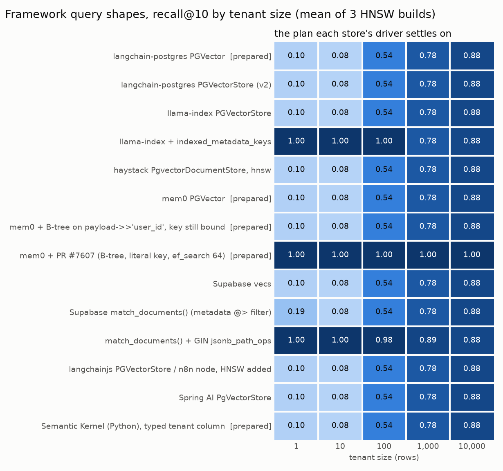
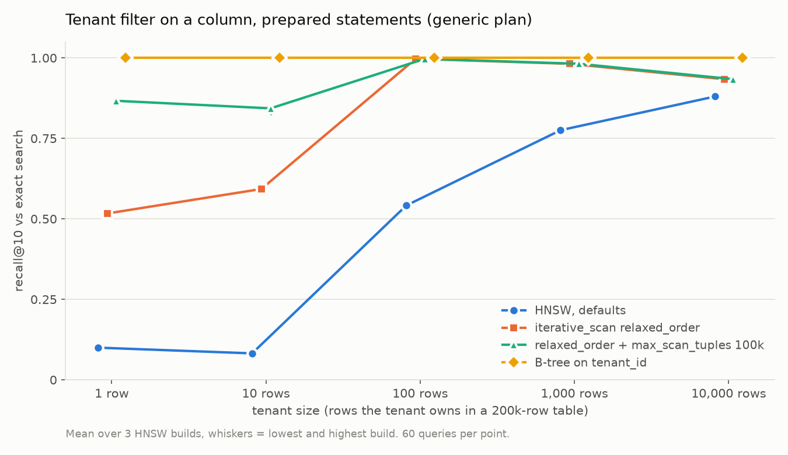
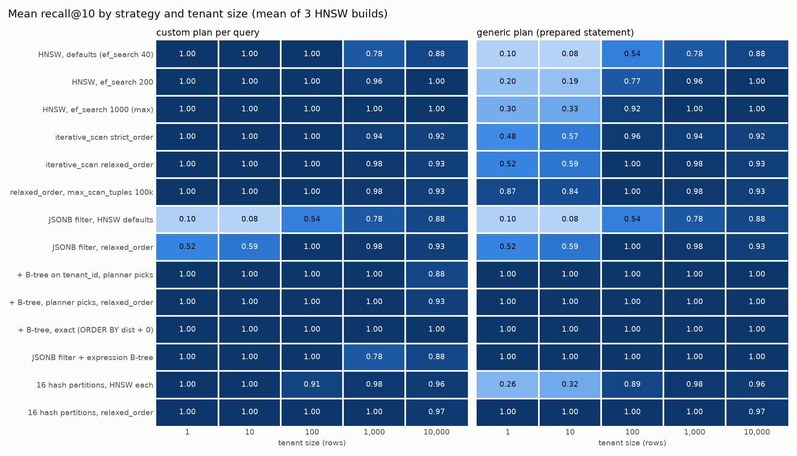

# pgvector-tenant-recall

A benchmark of what happens to filtered pgvector search when many tenants share one table.

The usual multi-tenant RAG setup is one `embeddings` table, one HNSW index, and
`WHERE tenant_id = $1 ORDER BY embedding <=> $2 LIMIT 10`. HNSW finds the nearest
rows first and applies the `WHERE` afterwards, so a tenant who owns a tiny slice of
the table can get fewer than 10 rows back, or none. This repo measures how often that
happens per tenant size, and which fixes actually close the gap.

Everything here was run on real PostgreSQL 17.12 with pgvector 0.8.7. Numbers below
come from `results/summary_by_strategy.csv` (mean of 3 separate HNSW index builds).



## What I found

Table: 200,000 rows, 2,115 tenants, 128-dim vectors, HNSW `m=16, ef_construction=64`,
k = 10, 60 queries per tenant size. Unfiltered HNSW recall@10 on the same table is
0.91 to 0.92 at the default `ef_search` of 40.

**1. A filter on a JSONB key is the worst case.** `metadata->>'user_id' = $1` has no
statistics, so the planner always picks the HNSW index, whatever the tenant size.

| tenant rows | recall@10 | queries that returned 0 rows | queries that came back short | p50 latency |
|---:|---:|---:|---:|---:|
| 1 | 0.10 | 90% | 90% | 1.2 ms |
| 10 | 0.08 | 67% | 100% | 1.0 ms |
| 100 | 0.54 | 18% | 63% | 0.9 ms |
| 1,000 | 0.78 | 6% | 34% | 1.0 ms |
| 10,000 | 0.88 | 2% | 11% | 1.1 ms |

**2. Most framework stores send exactly that query.** I read the current pgvector
store code of 12 projects and replayed the SQL of the 10 stores whose search goes
through HNSW (table below). 9 of those 10 put the tenant inside JSON or JSONB
metadata, and every one of those lands on the numbers above: 0.10 for 1-row tenants, 0.08 for 10-row tenants. They are identical
because the plans are identical: HNSW with `ef_search = 40` hands back the same 40
nearest rows however the filter is spelled, and the filter then throws most of them away.

**3. A plain column filter hides the problem until you prepare statements.** With a
`tenant_id` column, a plain query gets a custom plan per tenant: Postgres sees from its
stats that the tenant is small and does a sequential scan plus exact sort (recall 1.00,
about 35 ms here, and that grows with the table). Prepared statements change that.
psycopg 3 prepares a query after 5 executions, the PostgreSQL JDBC driver does the same
by default, and asyncpg prepares every statement. Postgres then plans a prepared
statement 5 times with the real values and switches to one generic plan if that plan
looks cheaper, which here it does. The generic plan uses HNSW for every tenant, and the
numbers drop to exactly the JSONB table above. I found this one by accident, when
psycopg switched plans a few queries into my first run and small tenants suddenly
started coming back empty. The bench now measures both modes on purpose.

The same thing happens inside a SQL function. Supabase's documented `match_documents()`
is plpgsql, and plpgsql caches its statements the same way: the first calls get a
sequential scan, then it settles on HNSW for everyone (0.19 for 1-row tenants, and that
0.19 is only the first few calls).



**4. Mid-size tenants lose even with good stats.** With custom plans the planner
switches to HNSW somewhere below 1,000 rows (0.5% of this table), where `ef_search = 40`
cannot fill 10 results: recall 0.78, and 34% of queries come back short. The cost model
doesn't know about post-filter shortfall.

**5. `hnsw.iterative_scan` helps, but not much for the smallest tenants.** Under the
generic plan:

| setting | 1 row | 10 rows | 100 rows | p50 latency, 1-row tenant |
|---|---:|---:|---:|---:|
| defaults | 0.10 | 0.08 | 0.54 | 1.2 ms |
| `ef_search = 200` | 0.20 | 0.19 | 0.77 | 3.3 ms |
| `ef_search = 1000` (the maximum) | 0.30 | 0.33 | 0.92 | 12 ms |
| `iterative_scan = strict_order` | 0.48 | 0.57 | 0.96 | 51 ms |
| `iterative_scan = relaxed_order` | 0.52 | 0.59 | 1.00 | 50 ms |
| relaxed + `max_scan_tuples = 100000` | 0.87 | 0.84 | 1.00 | 327 ms |

The default `max_scan_tuples` (20,000) stops the scan before it reaches a rare
tenant's rows in about half of the queries, and by then it has already spent more time
than a sequential scan would. Raising the limit gets closer but costs about 0.3 s per query.

The `ef_search = 1000` row comes with a warning. In my first run the table was about 3%
narrower (286 MB instead of 296 MB, before I added the framework columns), and at
`ef_search = 1000` the planner priced HNSW out and used a sequential scan: recall 1.00.
With the wider table the same setting picks HNSW and gets 0.30. Raising `ef_search`
until the planner gives up on the index is not a fix you can rely on.

**6. A B-tree on the tenant key fixes it, and the generic plan is the safest one.**
`CREATE INDEX ON items (tenant_id)` (or `ON items ((metadata->>'user_id'))` for the
JSONB case) gives recall 1.00 for every tenant size under the generic plan, at 0.15 ms
for small tenants and 5.4 ms for a 10,000-row tenant, because Postgres reads the tenant's
rows and sorts them exactly. The expression index also makes `ANALYZE` collect stats on
the JSONB key, which is half the fix. With custom plans the planner still sends
1,000-row and larger tenants through HNSW (0.78 and 0.88); add
`iterative_scan = relaxed_order` and the 10,000-row tenants get 0.93.

There is a catch for stores that bind the JSON key as a parameter. mem0 sends
`payload->>%s = %s`. An expression index on `payload->>'user_id'` works for custom
plans, but under psycopg's generic plan the key is `$1`, the index can't match, and
recall stays at 0.10. The fix proposed in mem0 PR #7607 (closed without merge) inlined
the key for exactly this reason, and with it every tenant size gets 1.00.

**7. Hash partitioning alone doesn't save small tenants on a generic plan** (0.26 and
0.32). With `relaxed_order` it reaches 1.00 at about 15 to 21 ms.

| fix (generic plan) | 1 row | 10 rows | 100 rows | 1,000 rows | 10,000 rows |
|---|---:|---:|---:|---:|---:|
| none | 0.10 | 0.08 | 0.54 | 0.78 | 0.88 |
| B-tree on tenant key | 1.00 | 1.00 | 1.00 | 1.00 | 1.00 (5.4 ms) |
| 16 hash partitions + relaxed_order | 1.00 | 1.00 | 1.00 | 1.00 | 0.97 |
| relaxed_order + max_scan_tuples 100k | 0.87 | 0.84 | 1.00 | 0.98 | 0.93 |

Filtering never leaked rows from other tenants. Every strategy returned only the
tenant's own rows; the failure mode is always missing rows, never wrong ones.

## The frameworks

Each store's search query was copied from its current source and replayed on the same
table and index (`ptr/frameworks.py` has the SQL and the file and line it came from). "Plan"
is where the store's driver ends up after a few calls. Recall is for 1-, 10- and 100-row
tenants.

| store (version, commit read) | filter it sends | vector index it creates | plan | recall 1 / 10 / 100 |
|---|---|---|---|---|
| langchain-postgres `PGVector` (0.0.19, 9afb650a) | `jsonb_path_match(cmetadata, '$.user_id == $value', ...)` | none (its GIN on `cmetadata` can't serve `jsonb_path_match`) | prepared | 0.10 / 0.08 / 0.54 |
| langchain-postgres `PGVectorStore` v2 (0.0.19) | `langchain_metadata->>'user_id' = $1` (json column) | opt-in HNSW | custom | 0.10 / 0.08 / 0.54 |
| llama-index `PGVectorStore` (0.9.0, baeabbfe) | `metadata_->>'user_id' = 'u1'` (literal) | opt-in HNSW | custom | 0.10 / 0.08 / 0.54 |
| same, with `indexed_metadata_keys` | same | opt-in HNSW + B-tree on `CAST(metadata_->>'user_id' AS VARCHAR)` | custom | 1.00 / 1.00 / 1.00 (1,000 rows: 0.78) |
| haystack `PgvectorDocumentStore` (8.2.1, 8515da62) | `meta->>'user_id' = %s` | none by default (exact search); HNSW opt-in, measured here | custom | 0.10 / 0.08 / 0.54 |
| mem0 (2.2.1, f1791daa) | `payload->>%s = %s` | HNSW by default | prepared | 0.10 / 0.08 / 0.54 |
| mem0 + the change in PR #7607 | `payload->>'user_id' = %s` | HNSW + expression B-tree | prepared | 1.00 / 1.00 / 1.00 |
| Supabase `vecs` (0.4.5, 240d8709) | `metadata -> 'user_id' = '"u1"'::jsonb` | `create_index()`: HNSW | custom | 0.10 / 0.08 / 0.54 |
| Supabase docs `match_documents()` | `metadata @> filter` in plpgsql | none on the page; HNSW measured | plpgsql cache | 0.19 / 0.08 / 0.54 |
| same + GIN `jsonb_path_ops` on `metadata` | same | HNSW + GIN | plpgsql cache | 1.00 / 1.00 / 0.98 |
| langchainjs `PGVectorStore` / n8n PGVector node (1.1.27, n8n 2.47.7) | `metadata->>'user_id' = $1` | only via `createHnswIndex()`, which n8n never calls; HNSW measured | custom | 0.10 / 0.08 / 0.54 |
| Spring AI `PgVectorStore` (2.0.2, 703119a1) | `metadata::jsonb @@ '$."user_id" == "u1"'::jsonpath` | HNSW | custom | 0.10 / 0.08 / 0.54 |
| Semantic Kernel Python (1.47.0, 3bbde09a) | `(tenant_id = %s)`, a real column | HNSW | prepared | 0.10 / 0.08 / 0.54 (custom plans: 1.00) |

Read but not replayed, because their query is one of the shapes above or doesn't run
through HNSW:

- **honcho** (v3.6.1) filters real columns on a table hash-partitioned by tenant and turns
  prepared statements off, so it gets custom plans. Its own issue #1048 reports 13 of 20
  results with default settings, and PR #1251 (open) turns on `iterative_scan`.
- **Letta** (archive branch 56ba9c25) stores 4096-dim embeddings, above pgvector's
  2,000-dim index limit, so archival search is an exact scan. Its tag filter runs in Python
  after the `LIMIT`, which can return fewer than k for a different reason.
- **pgai** documents `WHERE metadata->>'department' = 'finance' ORDER BY distance`, the
  haystack shape.
- **Semantic Kernel .NET** (now CommunityToolkit MEVD PgVector 1.0.2) defaults to
  `IndexKind.Flat`, which creates no vector index, so search is exact.
- **The Vercel AI SDK RAG guide** has no tenant filter. Its query sorts by
  `1 - (embedding <=> q) DESC`, and `EXPLAIN` shows a parallel sequential scan: the HNSW
  index the guide creates is never used by its own query.

None of the 12 projects sets `hnsw.iterative_scan` on its main branch (honcho has the open
PR). vecs, llama-index, langchain v2 and haystack let you set `ef_search`; it stays at 40
unless you do.

### One store end to end

The replays copy each store's SQL. To check that the copy behaves like the real thing,
`scripts/check_langchain_v2.py` runs langchain-postgres' own `PGVectorStore.asimilarity_search_by_vector`
with a `{"user_id": ...}` filter on the same 200k rows. The two `iterative_scan` rows use a local
patch that adds `iterative_scan` and `max_scan_tuples` to `HNSWQueryOptions` (0.0.19 only has
`ef_search`). Recall@10, range over two separate index builds:

| options | 1 row | 10 rows | 100 rows | 1,000 rows | p50, 1-row tenant |
|---|---:|---:|---:|---:|---:|
| default | 0.05-0.12 | 0.09 | 0.52-0.56 | 0.78 | 3 ms |
| `iterative_scan = strict_order` | 0.38-0.45 | 0.58 | 0.94-0.98 | 0.95-0.96 | 60-70 ms |
| strict + `max_scan_tuples = 100000` | 0.70-0.77 | 0.83-0.84 | 0.94-0.98 | 0.95-0.96 | 395-422 ms |
| B-tree on `(langchain_metadata->>'user_id')` | 1.00 | 1.00 | 1.00 | 0.78-0.79 | 1.6-1.7 ms |

The default row matches the replay above. The B-tree and the iterative scan fix different
tenant sizes. Combining them is `btree_planner_relaxed` in the main grid: 1.00 up to 1,000 rows,
0.93 for 10,000 rows with custom plans. `results/langchain_v2.json` has the latest run.

Full grid (custom and generic plans, 15 strategies):



## How it measures

- **Data.** Seeded synthetic vectors, not a public embedding set. Probe tenants own
  exactly 1, 10, 100, 1,000 and 10,000 rows (30/30/30/20/5 tenants); the rest of the
  table belongs to 2,000 background tenants with Zipf-distributed sizes. Vectors come
  from 200 shared topics with Zipf popularity (many tenants write about the same
  popular topics), plus a per-tenant offset. They are drawn in a 32-dim latent space and
  projected to 128 dims, because real text embeddings are low intrinsic dimension; with
  full-rank noise HNSW recall was unrealistically low (0.75 unfiltered). Queries are a
  tenant asking about one of its own topics. See `ptr/dataset.py`.
- **Ground truth.** Exact cosine distance over the tenant's rows in numpy, checked
  against a Postgres sequential scan on 25 sampled queries every run (no mismatch, max
  distance gap 9e-8).
- **Recall.** Hits divided by `min(k, tenant rows)`, so a 1-row tenant that gets its
  one row back scores 1.0. Ties at the k-th distance count as hits. Rows from another
  tenant would be counted separately as leaks. See `ptr/metrics.py` and its tests.
- **Plans.** Every custom-plan query gets its own `EXPLAIN`, because the plan depends on
  the tenant id. Generic-plan runs set `plan_cache_mode = force_generic_plan` and read
  the plan with `EXPLAIN (GENERIC_PLAN)`. `queries.csv` has the plan of every query.
- **Builds.** pgvector picks HNSW levels at random, so each index build is a slightly
  different graph. The bench rebuilds every index 3 times and reports the mean and the
  lowest and highest build. Builds differed by at most 0.10 recall for any one cell.
- **Framework replays** run on the same table, which carries every metadata shape at
  once: `metadata` jsonb (`{"user_id": ..., "chunk": ...}`), the same document in a
  `meta_json` json column, and a `collection_id` joined to a one-row `collections` table
  for langchain. Indexes a store creates are built before its run and dropped after.
  For `match_documents()` the plan inside the function is read with `auto_explain`.
- **Relaxed order** queries are wrapped in a `MATERIALIZED` CTE and re-sorted, as the
  pgvector README recommends.

Limits: one machine (2 vCPU, 4 GB RAM), one table size, 128 dimensions, synthetic data.
Latency numbers are for comparison between strategies on this box, not a capacity claim.

## Run it

Needs Python 3.11+ and a PostgreSQL with pgvector 0.8 or newer. The bench drops and
recreates its own tables (`items`, `items_part*`), so point it at a scratch database.

```bash
python -m venv .venv && .venv/bin/pip install -e '.[dev]'

# optional: a throwaway Postgres 17 + pgvector without root or Docker (Debian 12, amd64)
scripts/local-pg.sh start

.venv/bin/python -m ptr.bench --rows 200000 --builds 3    # about 25 minutes on 2 vCPU
.venv/bin/python -m ptr.charts results
.venv/bin/pytest
```

Useful flags: `--only hnsw_default btree_planner`, `--plan-cache generic`,
`--builds 1`, `--rows 500000`, `--dim 384`, `--tenant-offset 0`. `PTR_DSN` sets the
connection string (see `.env.example`).

`--dataset real` swaps the synthetic vectors for Simple English Wikipedia paragraphs embedded with
all-MiniLM-L6-v2 (`pip install -e '.[real]'`; the first run downloads about 160 MB and embeds 200k
chunks, which takes over an hour on 2 vCPU, then caches them). `scripts/check_langchain_v2.py`
needs `pip install -e '.[langchain]'`.

## Output

- `results/summary_by_strategy.csv`: mean recall, lowest/highest build, share of short
  and empty results, share of queries that used HNSW, p50/p95 latency.
- `results/summary.csv`: the same per build, with the plan mix.
- `results/queries.csv` (not committed, about 4 MB): every query with its plan.
- `results/run.json`: versions, dataset config, build times, sizes, sanity checks.

## Layout

```
ptr/dataset.py     seeded tenant layout and vectors, exact search
ptr/metrics.py     recall@k, short/empty results, percentiles
ptr/strategies.py  index layouts, settings and SQL shapes under test
ptr/frameworks.py  framework query replays, with the source file and lines of each
ptr/realdata.py    the Wikipedia + MiniLM dataset
ptr/db.py          schema, binary COPY load, index builds
ptr/bench.py       the runner
ptr/charts.py      PNG charts
scripts/           throwaway Postgres (local-pg.sh), langchain-postgres end-to-end check
tests/             pytest
```

## Licence

MIT. A personal project by Sunnatulla E.
